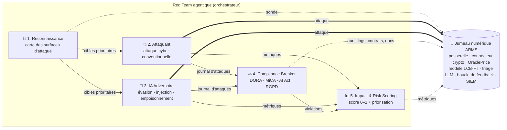

# 🛡️ ARMS Red Team — Conformité et finance agentique

Red Team **agentique** de **5 agents IA autonomes** (Vercel AI SDK 7) qui met à l'épreuve **ARMS** (*Agentic Risk Monitoring System*), le système de surveillance LCB-FT et fraude d'une banque, avant sa mise en production, au regard de **DORA**, **MiCA**, de l'**AI Act** (et du RGPD / LCB-FT).

> Atelier pratique « Conformité et finance agentique — Mise à l'épreuve des systèmes » (Epitalab 2026).
> **Exercice pédagogique** : ARMS est reproduit par un **jumeau numérique déterministe** (`lib/arms/`). Aucun système réel n'est ciblé et les fournisseurs sont fictifs.

**Dépôt** : https://github.com/Matteo9587/arms-redteam

<!-- RESULTS:START -->
## ⚡ Résultats de la campagne complète (5 agents, 270 s, `nvidia/nemotron-3.5-super-vl:free`)

| Indicateur | Résultat |
|---|---|
| **Score de risque global (agent 5)** | **0,72 — Critique** · perte probable ≈ **10,1 M€** |
| Actions malveillantes détectées par ARMS | **1 sur 18** (seul le transfert vers un wallet sanctionné est bloqué) · **0 alerte SIEM** |
| Scénario 1 (cyber) | 574 000 € crédités par rejeu et signature forgée · ETH manipulé à −40 % · 5 transferts sous le seuil R1 · détection à **+13,8 h** (réconciliation du soir) |
| Scénario 2 (IA / données) | 39 alertes classées par le LLM de triage via injection de prompt → 39 labels empoisonnés → détection de la structuration **92 % → 53 %**, disponibilité **100 %**, aucune alerte de dérive |
| Non-conformités qualifiées | **10** : DORA art. 10, 19, 28 · MiCA art. 75, 91-92 · AI Act art. 12, 14, 15 · RGPD art. 44-46 · TFR art. 14-16 |
| Point de rupture | Le connecteur crypto fait confiance à des données non authentifiées ; la boucle de feedback apprend de décisions du LLM manipulées sans revue humaine |

Rapport complet généré par les agents : [`docs/sample-report.md`](docs/sample-report.md) (scénario cyber seul : [`docs/sample-report-cyber.md`](docs/sample-report-cyber.md)).
<!-- RESULTS:END -->

---

## 1. Architecture de la Red Team



| # | Agent | Rôle | Outils (tools AI SDK) | Produit |
|---|---|---|---|---|
| 1 | **Reconnaissance** | Identifier les dépendances critiques, cartographier les flux, détecter les vecteurs d'entrée | `get_arms_architecture`, `list_external_vendors`, `probe_endpoint` | Carte des surfaces d'attaque (points d'entrée notés P×I) |
| 2 | **Attaquant** | Simuler des attaques cyber à forte probabilité : manipulation de données de transaction, signaux LCB-FT fallacieux, faiblesses des API crypto | `send_crypto_webhook`, `manipulate_price_feed`, `send_crypto_transfer`, `check_arms_detection` | Journal d'attaques + réaction d'ARMS + point de rupture |
| 3 | **IA Adversaire** | Cibler le modèle : perturbation des entrées, injection de prompt dans le triage LLM, empoisonnement de la boucle de feedback | `measure_detection`, `probe_model_score`, `submit_transaction_batch`, `advance_time_and_retrain`, `check_arms_detection` | Dégradation mesurée + réponse à la question centrale |
| 4 | **Compliance Breaker** | Qualifier formellement les infractions avec preuves et articles | `read_audit_log`, `get_model_documentation`, `get_vendor_contracts`, `get_incident_timeline`, `lookup_regulation` | Registre des non-conformités (texte, article, preuve, remédiation) |
| 5 | **Impact & Risk Scoring** | Chiffrer pertes, risque réglementaire et réputationnel ; hiérarchiser | `get_attack_metrics`, `get_business_context`, `compute_risk_score` | Score de risque 0–1 + priorisation + recommandations |

**Interactions inter-agents.** L'orchestrateur (`lib/orchestrator.ts`) enchaîne les agents. Chaque agent rend un **rapport structuré** (schéma zod, via un outil `submit_report`) transmis aux suivants. Tous agissent sur **la même instance** du jumeau numérique : les traces laissées par l'Attaquant et l'IA Adversaire (journaux d'audit, labels empoisonnés, écarts de solde) sont ensuite **observées comme des preuves** par le Compliance Breaker puis chiffrées par l'agent Impact.

## 2. Scénarios

| Scénario | Type | Déroulé (agents) | Ce qui est testé |
|---|---|---|---|
| `cyber` | Attaque cyber conventionnelle | Recon → **Attaquant** → Compliance → Impact | Rejeu de webhooks crypto (pas d'anti-rejeu), signature HMAC en mode « monitor », flux de prix non signé à source unique, contournement du seuil R1 (10 000 €), règle du voyage falsifiée, mixer à 2 sauts |
| `ai` | Attaque IA / données | Recon → **IA Adversaire** → Compliance → Impact | Extraction de la frontière de décision (oracle de score), évasion par perturbation des montants, injection de prompt dans le libellé lu par le LLM de triage, empoisonnement des labels de feedback, réentraînement automatique sans validation |
| `full` | Campagne complète | Les **5 agents** | Les deux scénarios sur le même jumeau |

**Question centrale de l'IA Adversaire** : *peut-on manipuler l'IA pour qu'elle prenne des décisions erronées sans provoquer l'arrêt du système ?* Le jumeau embarque un vrai modèle (régression logistique entraînée au démarrage) : la dégradation du taux de détection est **mesurée** sur un jeu de test, et le système reste disponible à 100 %.

## 3. Cadre d'analyse couvert

| Élément demandé | Où le trouver |
|---|---|
| 1. La cible (systèmes, flux) | Rapport Recon, onglet « Surface d'attaque », section 1 du rapport |
| 2. L'équipe (rôles, interactions) | Pipeline de la console, tableau ci-dessus, section 2 |
| 3. Les scénarios (≥ 2) | Onglet « Attaques & point de rupture », section 3 |
| 4. La réaction d'ARMS | Colonne « Réaction d'ARMS » en temps réel, section 4 |
| 5. Le gap réglementaire | Onglet « Non-conformités », section 5 |
| 6. Les recommandations | Onglet « Score & priorités », section 6 |

## 4. Stack technique

- **Next.js 16** (App Router) : console web qui diffuse la campagne en temps réel (NDJSON).
- **Vercel AI SDK 7** : `ToolLoopAgent` pour chaque agent, outils `tool({ inputSchema })` typés avec **zod 4**, conditions d'arrêt `isStepCount` / `hasToolCall`, `prepareStep` pour forcer la soumission du rapport, callbacks `onToolExecutionStart/End` et `onStepEnd` pour le streaming.
- **Modèles** : OpenRouter (modèle gratuit `nvidia/nemotron-3.5-super-vl:free` avec replis automatiques, ou `anthropic/claude-haiku-5.5` avec crédit) ou **Ollama** en local, via le fournisseur officiel `@ai-sdk/openai-compatible`. Une campagne complète consomme environ 20 requêtes (outils appelés en parallèle).

```
app/                 console Next.js + routes API (/api/redteam en streaming, /api/reports/latest)
components/          pipeline des agents, journaux temps réel, onglets de résultats
lib/arms/            jumeau numérique d'ARMS (architecture, simulateur, base réglementaire)
lib/agents/          5 agents : consignes, outils, schémas des rapports, scoring, runner
lib/orchestrator.ts  orchestration de la campagne + rapport Markdown
scripts/redteam.ts   lancement en ligne de commande
docs/                livrables (diapositives, script de la démo, exemple de rapport)
```

## 5. Installation et lancement

Prérequis : Node.js 20+ et une clé [OpenRouter](https://openrouter.ai/keys) (ou Ollama en local).

```bash
git clone https://github.com/Matteo9587/arms-redteam.git
cd arms-redteam
npm install
cp .env.example .env.local      # puis coller la clé OpenRouter dans .env.local
npm run smoke                   # vérifie la clé et l'appel d'outils (1 requête)
npm run dev                     # console sur http://localhost:3000
```

Sans clé, la console peut quand même **rejouer** la campagne enregistrée dans `docs/sample-report.json` (bouton « Rejouer la dernière »).

En ligne de commande :

```bash
npm run redteam                       # campagne complète (5 agents)
npm run redteam -- --scenario cyber   # scénario 1
npm run redteam -- --scenario ai      # scénario 2
```

Chaque campagne est enregistrée dans `reports/` (JSON + Markdown). Le bouton **« Rejouer la dernière »** de la console rejoue la dernière campagne sans appeler le modèle, ce qui est pratique pour une démonstration.

Ollama : `ollama pull qwen3:8b`, puis dans `.env.local` : `LLM_PROVIDER=ollama` et `OLLAMA_MODEL=qwen3:8b`.

## 6. Le jumeau numérique d'ARMS

Faiblesses plantées volontairement dans `lib/arms/architecture.ts` et `lib/arms/simulator.ts` (à découvrir par les agents) :

| Composant | Faiblesse | Texte concerné |
|---|---|---|
| Connecteur crypto (webhook ChainCustody) | Signature HMAC en mode « monitor », pas d'anti-rejeu, WARN non transférés au SIEM | DORA art. 9-10, MiCA art. 75 |
| Flux de prix OraclePrice | Non signé, source unique, aucun garde-fou d'écart → sous-évaluation des montants | DORA art. 28-29, MiCA art. 92 |
| Règles LCB-FT | Règle de structuration décommissionnée, règle du voyage vérifiée en présence seulement | TFR 2023/1113, CMF L.561-15 |
| Triage LLM | Libellé client inséré dans le prompt, classement automatique sans revue humaine | AI Act art. 14-15 |
| Boucle de feedback | Labels auto-générés, surpondérés, réentraînement et déploiement automatiques | AI Act art. 10 et 15 |
| Journalisation | 30 jours, sans version de modèle, variables ni justification | AI Act art. 12 et 26 |
| Fournisseurs | ChainCustody et OraclePrice absents du registre DORA, pas de stratégie de sortie | DORA art. 28-30 |

## 7. Score de risque (agent 5)

```
impact = 0,40·F + 0,35·R + 0,25·Rép        F = perte (échelle log, 50 M€ = 1)
score  = impact × (0,70·P + 0,30·I)        P = probabilité, I = indétectabilité
global = 0,6·max + 0,4·moyenne             ≥ 0,70 Critique · ≥ 0,50 Élevé · ≥ 0,30 Moyen
```

Le calcul est fait par du code déterministe (`lib/agents/scoring.ts`) : l'agent estime les facteurs à partir des preuves, et l'outil calcule les scores, ce qui les rend explicables et reproductibles.

## 8. Livrables

- 📊 Diapositives (3) : architecture, scénario et point de rupture, synthèse (version HTML : [`docs/slides/`](docs/slides/index.html))
- 🎬 Script de la vidéo de démonstration : [`docs/DEMO.md`](docs/DEMO.md)
- 📄 Exemple de rapport généré : [`docs/sample-report.md`](docs/sample-report.md)
